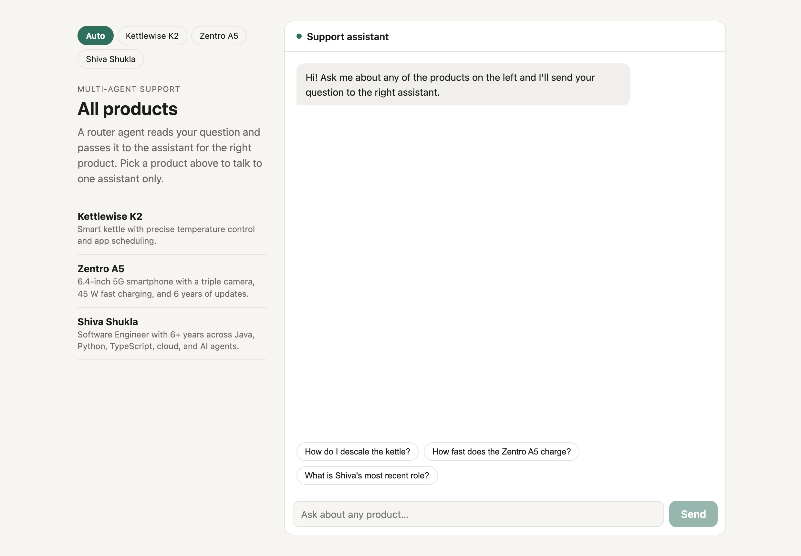
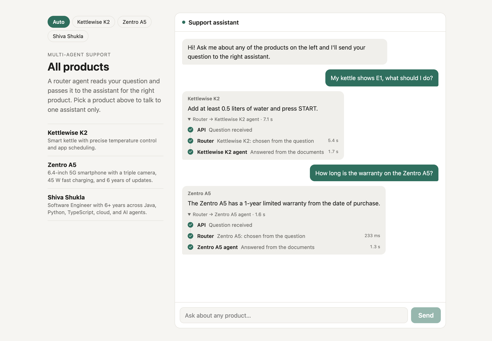
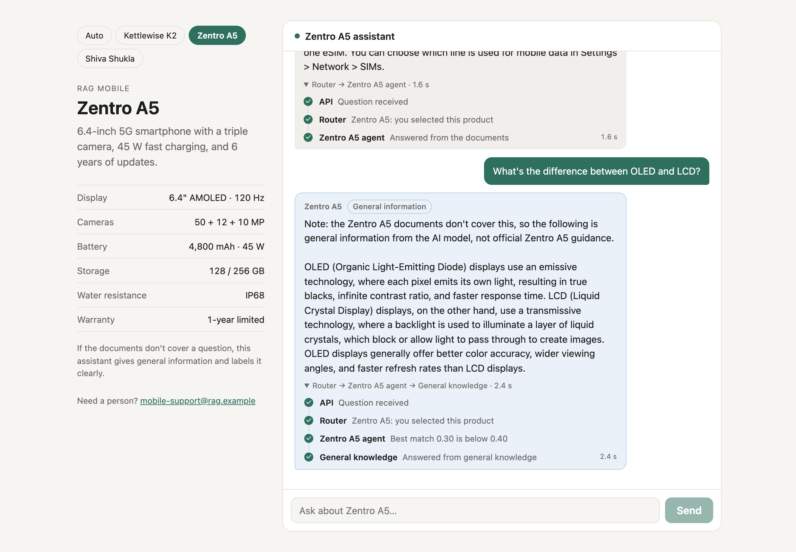
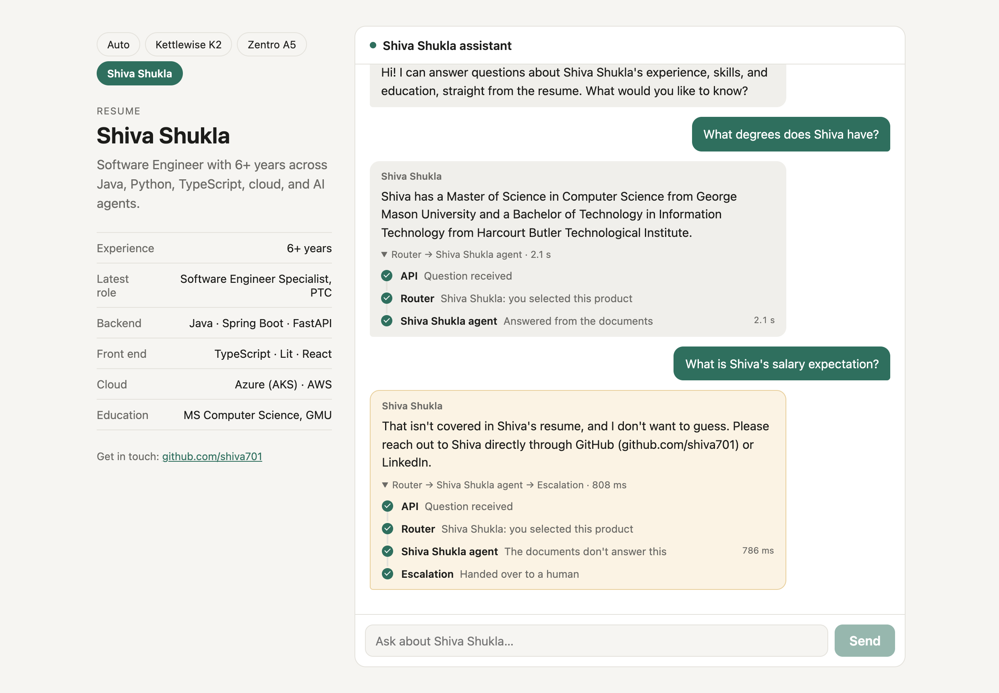

# Multi-Product Support Bot

A local, multi-agent RAG (retrieval-augmented generation) support bot built with LangGraph. Every folder in `kb/` is a product with its own documents and its own agent. A router agent reads each question and passes it to the right product agent.

| Product (`kb/<id>/`) | What it answers | When the docs don't have the answer |
|---|---|---|
| `kettle` | The fictional *Kettlewise K2* smart kettle | Escalates to a human |
| `phone` | The fictional *Zentro A5* smartphone | Gives general smartphone information from the chat model, with a notice that it didn't come from the docs |
| `resume` | Shiva Shukla's professional background | Escalates (never guesses facts about a person) |

Each agent answers only from its own docs; the API also returns the document sections each answer used. Everything runs on your machine: no API keys or usage costs.

```
question -> router -> kettle_agent | phone_agent | resume_agent -> answer from the docs
               |                          |
               |                          +-> general_agent (phone only) -> general answer + notice
               |                          +-> escalate -> "contact support"
               +-> clarify -> "which product do you mean?"
```

Print the real graph as a Mermaid diagram with `python graph.py`.

## Screenshots

**Start screen.** In Auto mode the router picks the product for each question. The buttons at the top left switch to a single product's assistant.



**Routing.** Two questions in one conversation go to two different agents. Each reply shows which agent answered and the steps the agents took, with how long each step ran.



**General-knowledge fallback (phone only).** The first answer comes from the Zentro A5 docs. The second question isn't covered by the docs, so the general-knowledge agent answers and the reply is labelled and starts with a notice.



**Resume and escalation.** The resume agent answers from the resume. When the resume doesn't cover a question, it declines instead of guessing.



| Part | Tool |
|---|---|
| Embeddings | Hugging Face model via `sentence-transformers` (default `google/embeddinggemma-300m`) |
| Chat model | Ollama (default `llama3.2`) |
| Agents | LangGraph (`graph.py`) |
| API | FastAPI on port 8000 |
| Web UI | React + Vite on port 5173 |

---

## 1. Prerequisites

- **Python 3.12+** and **Poetry 2.0+**
- **Node.js 18+** and npm (only for the web UI)
- **Ollama**: install from https://ollama.com
- **Hugging Face account** (only for gated models such as `google/embeddinggemma-300m`)

---

## 2. One-time setup

### Python environment

Dependencies are managed with [Poetry](https://python-poetry.org) (2.0+) and declared in `pyproject.toml`.

```bash
pipx install poetry          # or: brew install poetry
cd product-support-bot
poetry install               # creates ./.venv (see poetry.toml) and installs deps
source .venv/bin/activate    # or prefix commands with `poetry run`
```

Add or remove packages with `poetry add <pkg>` / `poetry remove <pkg>`; commit both `pyproject.toml` and `poetry.lock`.

### Chat model

```bash
ollama pull llama3.2
```

### Hugging Face access (gated embedding model)

`google/embeddinggemma-300m` requires accepting Google's license:

1. Open https://huggingface.co/google/embeddinggemma-300m and accept the terms.
2. Create a **Read** token at https://huggingface.co/settings/tokens.
3. Log in once:

   ```bash
   hf auth login        # older versions: huggingface-cli login
   ```

   Or add `HF_TOKEN=hf_...` to `.env`.

The model downloads on first use and is cached in `~/.cache/huggingface/`. After that it runs locally.

> To skip this step, use a non-gated model such as `BAAI/bge-small-en-v1.5` or `all-MiniLM-L6-v2` (see [Changing models](#8-changing-models)).

### Environment file

Create `.env` in the project root:

```dotenv
EMBED_MODEL=google/embeddinggemma-300m
CHAT_MODEL=llama3.2
# HF_TOKEN=hf_...   # only if you didn't use `hf auth login`
```

Never commit `.env` or share your token.

### Web UI dependencies

```bash
cd frontend
npm install
cd ..
```

---

## 3. Build the index

Run this the first time, and again whenever you edit files in `kb/` or change `EMBED_MODEL`:

```bash
source .venv/bin/activate
python ingest.py            # all products
python ingest.py phone      # one product
```

This splits each product's docs into sections, embeds them, and saves one index per product to `index/<product>/`.

---

## 4. Run the application

**Ollama must be running.** Open the Ollama app, or run `ollama serve` in a terminal. Check it with:

```bash
curl localhost:11434        # should print "Ollama is running"
```

### Start the servers

Use two terminals.

```bash
# Terminal 1: API (project root)
source .venv/bin/activate
uvicorn api:app --reload --port 8000
```

```bash
# Terminal 2: UI
cd frontend
npm run dev
```

Open **http://localhost:5173**. Choose **Auto** to let the router pick the product for each question, or choose a product to talk to its agent only. Each reply shows which agent answered; click the line under a reply to see the steps the agents took.

### Stop the servers

If a server is running in your terminal, press **Ctrl+C** in that terminal.

If it's running in the background, or you're not sure where it is, stop both servers by port:

```bash
lsof -ti tcp:8000 | xargs kill    # API (uvicorn)
lsof -ti tcp:5173 | xargs kill    # UI (Vite)
```

Or by name:

```bash
pkill -f "uvicorn api:app"        # API
pkill -f vite                     # UI (stops every Vite server, including other projects)
```

Check that both are stopped (no output means nothing is listening):

```bash
lsof -i tcp:8000 -i tcp:5173
```

If a server won't stop, force it with `kill -9`, e.g. `lsof -ti tcp:8000 | xargs kill -9`.

If you started the API from the VS Code debugger, stop it with the red stop button or **⇧F5**.

Ollama keeps running separately. Quit it from the menu bar icon or with `pkill ollama` if you want to free its memory.

---

## 5. API

**Ask a question**

```bash
curl -X POST http://localhost:8000/api/chat \
  -H "Content-Type: application/json" \
  -d '{"question": "My kettle shows E1, what do I do?"}'
```

Optional request fields:

| Field | Use |
|---|---|
| `product_id` | `"kettle"`, `"phone"`, or `"resume"`: skip the router and ask that product's agent |
| `thread_id` | Any string. Send the same one for every turn of a conversation so follow-up questions stay with the same product |

Response:

```json
{
  "found": true,
  "answer": "Add at least 0.5 liters of water and press START.",
  "citations": ["troubleshooting.md#Error Code E1"],
  "refused_by": null,
  "source": "docs",
  "product": "kettle",
  "product_name": "Kettlewise K2",
  "routed_by": "router",
  "trace": [
    {"agent": "router", "detail": "Kettlewise K2: chosen from the question"},
    {"agent": "kettle_agent", "detail": "answered from the documents"}
  ],
  "thread_id": "..."
}
```

- `source` is `"docs"` for a cited answer, or `"general"` when the answer came from the chat model's general knowledge (phone only). General answers always start with a notice and have no citations.
- When the bot refuses, `found` is `false`, `source` is `null`, and `refused_by` is `"retrieval_gate"`, `"model"`, `"model_error"` (the model's reply was unusable), or `"router"` (no product matched).

**Ask a question and watch the agents work (streaming)**

`POST /api/chat/stream` takes the same request but streams newline-delimited JSON: a `progress` event each time an agent starts, updates or finishes, then one `answer` event with the same fields as `/api/chat`. The web UI uses this endpoint for its live activity panel.

```bash
curl -N -X POST http://localhost:8000/api/chat/stream \
  -H "Content-Type: application/json" \
  -d '{"question": "How do I descale the kettle?"}'
```

```json
{"type": "progress", "agent": "api", "status": "done", "detail": "Question received"}
{"type": "progress", "agent": "router", "status": "running", "detail": "Reading the question to pick a product"}
{"type": "progress", "agent": "router", "status": "done", "detail": "Kettlewise K2: chosen from the question"}
{"type": "progress", "agent": "kettle_agent", "status": "running", "detail": "Searching the Kettlewise K2 documents"}
{"type": "progress", "agent": "kettle_agent", "status": "running", "detail": "Found 4 matching sections, writing the answer"}
{"type": "progress", "agent": "kettle_agent", "status": "done", "detail": "answered from the documents"}
{"type": "answer", "found": true, "answer": "...", "citations": ["user_manual.md#Descaling"], ...}
```

If something fails after the stream has started, the last event is `{"type": "error", "detail": "..."}` instead of `answer`.

**List the products**

```bash
curl http://localhost:8000/api/products
```

**Health check**

```bash
curl http://localhost:8000/api/health
```

Interactive docs: **http://localhost:8000/docs**. To use the curl in Postman, choose **Import** and paste it.

---

## 6. Tune and evaluate

```bash
source .venv/bin/activate

python calibrate.py     # suggests a min_score refusal threshold for each product
python evaluate.py      # grades each agent against kb/<product>/eval_set.json, then the router
```

Add a product id to run one product only, e.g. `python evaluate.py phone`.

`evaluate.py` reports three scores per product, plus one for the router:

| Score | Measures |
|---|---|
| Decision | Answered from the docs, answered from general knowledge, or refused, as expected |
| Retrieval hit rate | The right doc section was found |
| Answer content correct | The answer contains the key facts |
| Routing accuracy | Without being told the product, the router sent the question to the right agent |

Set `min_score` in `kb/<product>/product.toml` from the calibration output. If the two groups of scores overlap, lean low and let the model handle borderline questions.

---

### Lint and format

[Black](https://black.readthedocs.io) formats the code and [Pylint](https://pylint.readthedocs.io) lints it. Both are dev dependencies (`poetry install --with dev`) and are configured in `pyproject.toml` (100-character lines, Python 3.12).

```bash
black .                          # format
pylint *.py                      # lint
black --check . && pylint *.py   # check only, e.g. before a commit
```

To silence a Pylint warning on purpose, add a comment on that line with the reason, e.g. `# pylint: disable=import-outside-toplevel`.

---

## 7. Products

### Add a product

1. Create `kb/<id>/` (the folder name is the product id).
2. Add the documents as `.md` files. Each file needs one `# Title` and a `## Heading` for every section; each section becomes one searchable chunk.
3. Copy a `product.toml` from another product and edit it.
4. Optionally add `eval_set.json` with test questions.
5. Run `python ingest.py <id>`, then `python calibrate.py <id>`, and restart the API.

No code changes are needed: the graph creates one agent per folder, and the UI reads the product list from the API.

### Settings in `product.toml`

| Setting | What it does |
|---|---|
| `name`, `brand`, `tagline`, `specs`, `welcome`, `suggestions`, `contact_*` | What the web UI shows |
| `description` | What the router reads to decide if a question belongs to this product |
| `persona`, `subject`, `general_scope`, `example_no`, `example_missing` | Fill the blanks in the shared answer prompt (`SYSTEM_PROMPT` in `rag.py`) |
| `top_k`, `min_score` | How many sections go to the model, and the retrieval refusal threshold |
| `escalation_message` | The reply when the agent can't answer |
| `general_fallback` | `true`: when the docs have no answer, answer from the chat model's general knowledge instead of escalating |
| `general_topic` | The only topic the general answer may cover; anything else is still escalated |
| `general_notice` | The sentence put in front of every general answer |

### How the general-knowledge fallback works

Only the phone has `general_fallback = true`. When the phone agent can't answer from its docs (the retrieval score is too low, or the model says the sections don't answer it), the question goes to `general_agent`. That agent may only give general information about `general_topic`, and is told never to state facts specific to the product, such as its price or features. The notice is added in code, so it is always there. If the question is off-topic, it is escalated as usual.

---

## 8. Changing models

### Chat model

Any model from `ollama list` works:

```bash
ollama pull gemma4
```

Set `CHAT_MODEL=gemma4` in `.env`, then restart the API. No re-indexing needed.

### Embedding model

`embedding.py` uses `sentence-transformers`, which loads **Hugging Face** models only (not Ollama models).

1. Set `EMBED_MODEL` in `.env`, e.g. `BAAI/bge-small-en-v1.5`.
2. Rebuild and re-tune:

   ```bash
   rm -rf index/
   python ingest.py
   python calibrate.py     # update min_score in each product.toml
   python evaluate.py
   ```

3. Restart the API.

> Always search with the same embedding model you indexed with. Changing it without re-running `ingest.py` breaks retrieval.

---

## 9. Project structure

```
product-support-bot/
├── .env              # model settings (not committed)
├── config.py         # models and default settings
├── products.py       # loads kb/*/product.toml into the product registry
├── loader.py         # reads a product's *.md files
├── chunker.py        # splits docs into one chunk per section
├── embedding.py      # text -> vectors (sentence-transformers)
├── vector_store.py   # saves, loads, and searches an index
├── ingest.py         # builds index/<product>/
├── rag.py            # retrieval, prompts, and the Ollama calls
├── graph.py          # LangGraph: router, product agents, general agent, escalation
├── bot.py            # answer(): runs the graph for one question
├── api.py            # FastAPI server
├── calibrate.py      # threshold helper
├── evaluate.py       # eval runner
├── kb/
│   ├── kettle/       # product.toml, docs, eval_set.json
│   ├── phone/
│   └── resume/
├── index/            # generated by ingest.py
└── frontend/         # React UI
```

---

## 10. Troubleshooting

| Problem | Fix |
|---|---|
| `Connection refused` on port 11434, or API returns 503 | Start Ollama (`ollama serve` or the app) |
| `model "llama3.2" not found` | `ollama pull llama3.2` |
| `401 Unauthorized` from huggingface.co | Accept the model license and log in (see setup) |
| `No index for '<product>'` | Run `python ingest.py` |
| Shape mismatch or nonsense scores after a model change | `rm -rf index/` then `python ingest.py` |
| Bot refuses questions the docs answer | Lower `min_score` in that product's `product.toml`, or try a stronger embedding model |
| A question goes to the wrong product | Make that product's `description` in `product.toml` more specific, or pick the product in the UI |
| Right section found but answer says "not sure" | Try a bigger chat model, e.g. `CHAT_MODEL=gemma4` |
| First answer is slow | Ollama is loading the model; later answers are faster |
| UI says "Couldn't reach the support bot" | Start the API on port 8000 |
